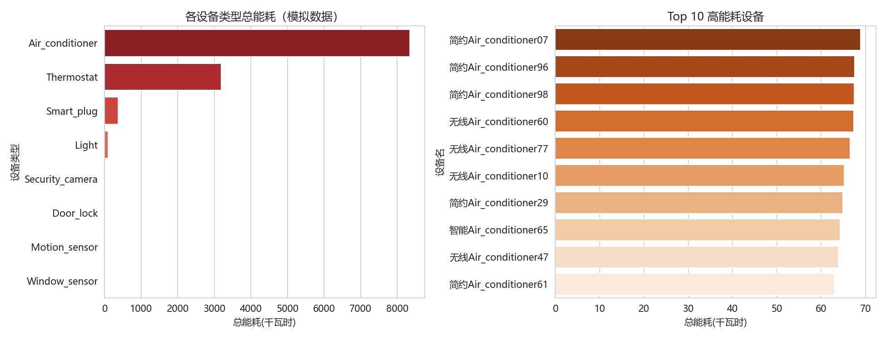
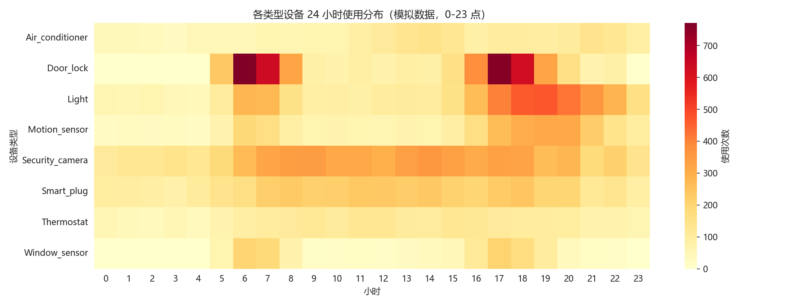
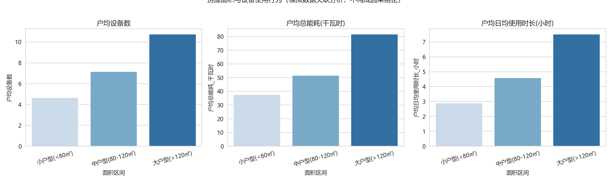
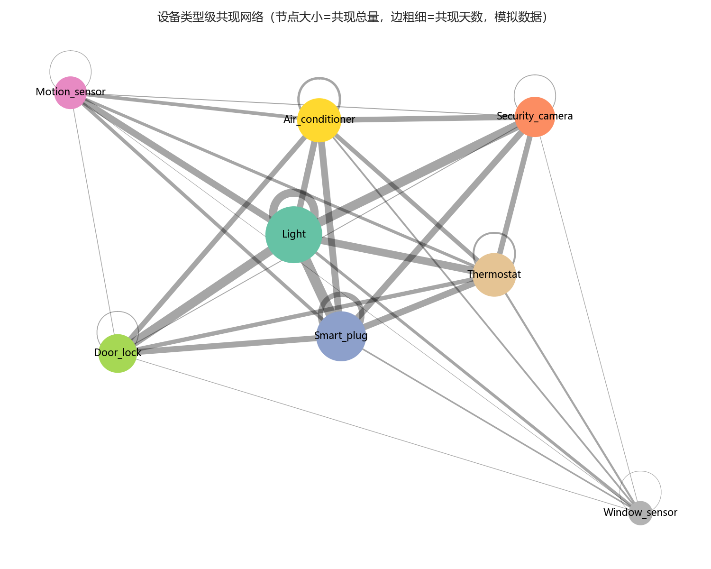

# 智能家居用户行为数据库与分析系统

一套从数据建模到分析洞察的完整数据项目：SQLAlchemy 定义 6 张关联表 → 可复现的模拟数据生成器 → FastAPI 数据查询服务 → pandas / matplotlib / NetworkX 多维分析。

## 分析图表预览

| 能耗分析 | 24 小时使用热力图 |
|---|---|
|  |  |
| **面积分组分析** | **设备类型共现网络** |
|  |  |

---

## 1. 项目做了什么

智能家居场景下，一个家庭会产生设备、使用记录、安防事件、用户反馈等多类数据，这些数据之间存在明确的关联关系。本项目围绕「数据怎么建、数据怎么造、数据怎么查、数据怎么分析」四件事展开：

| 环节 | 内容 |
|---|---|
| **数据建模** | 设计用户、设备、使用记录、安防事件、用户反馈、设备共现 6 张关联表，落地外键级联、枚举与 CHECK 约束、唯一约束、自动计算生成列、复合索引 |
| **数据生产** | 编写带 4 条业务规则的模拟数据生成器，固定随机种子 → 结果可复现，先清空再生成 → 幂等重跑不累加；产出 200 用户 / 1586 设备 / 2.8 万+ 条使用记录 |
| **数据服务** | 基于 FastAPI 实现 6 个查询接口（多维筛选、日期范围、能耗 Top-N、反馈评分区间等），自动生成在线交互文档 |
| **数据分析** | 完成数据质量、能耗结构、面积分组、时段分布、共现网络 5 组分析，输出 CSV 明细表与解释性图表 |

## 2. 技术栈

- **数据层**：SQLAlchemy 2.x（ORM）+ SQLite（生成列、CHECK 约束、复合索引）
- **服务层**：FastAPI + Uvicorn + Pydantic（响应模型校验、自动 API 文档）
- **分析层**：pandas（聚合透视）、matplotlib / seaborn（可视化）、NetworkX（网络图）
- **数据生成**：内置业务规则的生成器，固定种子保证可复现

---

## 3. 环境准备与运行流程

### 3.1 安装依赖

```powershell
# 项目根目录下（建议虚拟环境）
python -m venv .venv
.\.venv\Scripts\Activate.ps1        # 若报执行策略错误：Set-ExecutionPolicy -Scope CurrentUser RemoteSigned
pip install fastapi uvicorn sqlalchemy pandas matplotlib seaborn networkx
```

依赖清单同 `requirements.txt`。

### 3.2 初始化数据库并生成数据

```powershell
# 首次运行自动建表；重复运行会先清空再重建，不会累加
python -m scripts.seed_data
```

预期输出：200 用户 / 1586 设备 / 28255 使用记录 / 3338 共现 / 1421 安防事件 / 391 反馈，同时在 `outputs/` 下生成 `06_反馈抽样人工检查记录.csv`。

### 3.3 启动数据服务

```powershell
python -m uvicorn app.main:app --reload
```

浏览器打开 `http://127.0.0.1:8000/docs`，可交互测试全部 6 个接口。`Ctrl + C` 停止服务。

### 3.4 运行分析

```powershell
python -m analysis.analyze
```

结果全部写入 `outputs/`：6 份 CSV 明细表 + 4 张图表 + 1 份共现结论文本。

### 3.5 目录结构

```
├── app/
│   ├── database.py      # 连接配置（绝对路径，不受运行目录影响）
│   ├── models.py        # 6 张表的 ORM 模型
│   ├── schemas.py       # Pydantic 响应模型
│   └── main.py          # FastAPI 入口与 6 个接口
├── scripts/
│   ├── seed_data.py               # 模拟数据生成（4 条业务规则）
│   └── feedback_generator.py      # 反馈模板生成器 + LLM 可选入口
├── analysis/
│   └── analyze.py       # 5 组分析
├── data/
│   └── smart_home.db    # SQLite 数据库（.gitignore 已排除）
├── outputs/             # 分析产物（CSV / PNG / TXT）
├── verify_tables.py     # 建表验证脚本
└── requirements.txt
```

---

## 4. 数据表设计

| 表 | 说明 | 关键约束与索引 |
|---|---|---|
| `users` | 用户，含房屋面积 `house_size` | `email` 唯一 |
| `devices` | 设备，属于某用户 | `user_id → users.id`，`ON DELETE CASCADE` |
| `device_usages` | 使用记录（起止时间、能耗） | `device_id` 级联删除；`duration` 为**生成列**（秒，由起止时间自动计算）；索引 `(device_id, start_time)` |
| `security_events` | 安防事件 | `device_id` 级联删除；`severity` 枚举；索引 `(device_id, timestamp)` |
| `user_feedbacks` | 用户反馈 | `user_id` 级联删除；`device_id` **SET NULL**（删设备保留反馈历史）；`rating` CHECK 1~5；`generated_by` 记录生成方式 |
| `device_co_occurrences` | 设备共现（同一天使用时间重叠） | 三个外键全部级联；`UNIQUE(user_id, device1_id, device2_id)`；约定 `device1_id < device2_id` |

关系链：`users 1—N devices 1—N device_usages`；`devices 1—N security_events`；`users 1—N user_feedbacks N—1 devices（可空）`；`users 1—N device_co_occurrences N—2 devices`。

设计上的几个取舍：

- **反馈表的 `device_id` 用 SET NULL 而非 CASCADE**：设备下线后用户评价仍有分析价值，因此只解绑不删除。
- **`duration` 用生成列**：时长永远由起止时间推导，避免手工写入与时间字段不一致。
- **共现表建唯一约束**：同一对设备在同一用户下只允许一条记录，`occurrence_count` 承担"次数"语义。

---

## 5. 数据生成规则

随机种子固定为 42、"当前时间"固定为 2026-11-11 12:00，**同一脚本任何时候运行结果完全一致**。生成器刻意内置 4 条业务规律，使后续分析能验证「规律是否可被发现」：

1. **面积 → 设备数量**：每 15㎡ 约配 1 台设备，允许 ±2 台随机例外（实测面积与设备数相关系数 0.93）。
2. **设备类型 → 使用频率与能耗**：空调单次 1~6 小时、功率 1.2 kW；门锁 / 传感器每天多次但单次仅几十秒。
3. **时段 → 使用模式**：灯光晚间双峰、门锁早晚通勤峰、空调午后 + 夜间。
4. **共现由使用记录推导**：同一用户**同一天内**时间区间重叠的设备对才算共现，`occurrence_count` = 发生重叠的天数（每天去重计 1 次），跨午夜记录同时归入两天，不使用随机编造。

反馈文本由独立生成器产出：特征词按设备类型从特征库抽取、语气由评分决定，保证「文本与设备、评分一致」；每条记录写入 `generated_by` 字段（`template_v1` 或 `llm:模型名`）用于溯源，并支持抽样人工核查。

---

## 6. 接口清单

| 接口 | 说明 | 主要参数 |
|---|---|---|
| `GET /users` | 用户列表 | `limit`、`offset` |
| `GET /devices` | 设备查询 | `user_id`、`type`、`room` |
| `GET /usages` | 使用记录 | `device_id`、`start`、`end` |
| `GET /analytics/energy` | 设备能耗汇总 Top-N | `user_id`、`top` |
| `GET /security-events` | 安防事件 | `device_id`、`severity` |
| `GET /feedbacks` | 用户反馈 | `user_id`、`device_id`、`min_rating`、`max_rating`、`generated_by` |

全部接口可在 `/docs` 页面直接交互测试。

---

## 7. 分析口径与主要发现

| 分析 | 口径 | 主要发现 |
|---|---|---|
| 数据质量 | 各表行数、外键孤儿数、负 / 零时长、负能耗、时间覆盖 | 孤儿记录 0、负值 0；覆盖 2026-10-12 ~ 11-11 完整 30 天 |
| 能耗 | 按类型汇总总量、平均单次能耗、**单台平均能耗**（区分"设备多所以总量高"与"单台能耗高"） | 空调占总能耗 **69.5%**（总 8341 度，单台平均 41.7 度），恒温器 26.6%；空调既是总量冠军也是单台冠军 |
| 面积分组 | 按 <80 / 80-120 / >120㎡ 三档比较户均设备数、户均能耗、户均日均时长 | 户均设备 4.7 → 7.2 → 10.8 台；户均能耗 37.6 → 51.6 → 81.7 度；r(面积, 设备数)=0.93 |
| 时段 | 按小时统计各类型使用次数 | 灯光 17-23 点占 56%、门锁通勤时段占 69%，热力图双峰清晰 |
| 共现 | 同用户同日使用重叠；类型级聚合后按共现天数排序 | 最高频组合「灯光 + 智能插座」（492 天，占 7.9%），其次「灯光 + 摄像头」「门锁 + 灯光」 |

产物对应关系：`01_数据质量报告.csv`、`02_设备类型能耗汇总.csv` + `02_能耗分析.png`、`03_面积分组分析.csv/.png`、`04_时段分布.csv` + `04_时段热力图.png`、`05_高频设备对Top15.csv` + `05b_类型共现网络.png` + `05c_共现分析结论.txt`。

---

## 8. 重要限制：数据是模拟的

- 全部数据由带业务规则的生成器产出，**不是真实用户数据**。面积、时段等结论只能表述为"模拟规则生成的数据中观察到的关联"，**不能作为真实用户行为结论，更不能表述为因果关系**。
- 仅覆盖 30 天窗口，**不支持季节性、节假日效应等长周期结论**。
- 单台设备能耗 = 额定功率 × 使用时长，为简化模型，未考虑变频、负载变化、待机功耗等因素。
- 单一 SQLite 文件、单机部署，未涉及并发写入与大规模性能优化。
- 用户反馈默认模板生成（`template_v1`）。项目预留大模型生成入口，配置 API Key 后可切换，但**不把模板产物表述为 LLM 生成**。

**后续计划**：导入公开真实用电数据集（如 UCI 家庭用电数据集），在同一套表结构与分析脚本上做真实数据分析，形成"模拟验证方法 + 真实数据出结论"的双数据源结构。

---

## 9. 常见问题

| 现象 | 原因与解决 |
|---|---|
| `ImportError: attempted relative import with no known parent package` | 直接运行了 `app/models.py` 等模块文件。这些文件只被导入、不单独运行；统一用 `python -m scripts.seed_data` / `python -m analysis.analyze` |
| 终端输入 `python` 无任何反应 | Windows「应用执行别名」中的商店占位程序。关闭别名（设置 → 应用执行别名 → 关闭 python.exe/python3.exe），或改用 Python 完整路径 |
| 图表中文显示为方框 | 缺少中文字体。代码已设字体回退列表（微软雅黑 / 黑体 / Noto Sans CJK），Linux 环境可安装 `fonts-noto-cjk` |
| `Address already in use` | 8000 端口被占用，换端口：`python -m uvicorn app.main:app --reload --port 8001` |
| Excel 打开 CSV 乱码 | 输出已使用 `utf-8-sig` 编码；若仍乱码请用「数据 → 从文本导入」并选 UTF-8 |
| 换机器后数据跑到奇怪目录 | 数据库路径已用 `__file__` 定位项目根目录，不受运行位置影响；若仍异常请检查 `app/database.py` |
